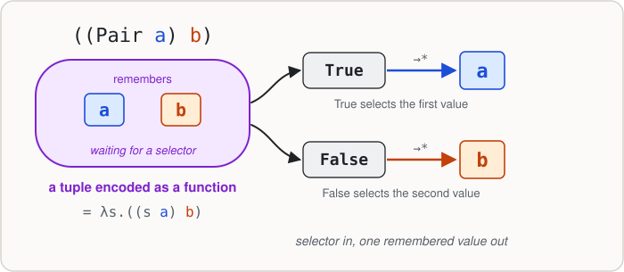

# Module 08.2: Encoding Data with Functions

In Module 08.1, you learned a language with exactly three kinds of expression (variables, applications, and lambda abstractions) and one rule for computing with them, β-reduction. That raises an obvious question. Real programs need truth values, pairs, lists, and numbers, and the lambda calculus has none of these built in. Where do they come from?

The answer in this module is that we don't add them. We **encode** them: for each kind of data, we find a function that *behaves* the way that data is supposed to behave. A Boolean will be a function that chooses, a pair will be a function that remembers, and a number will be a function that repeats. This is the course theme **Functions Are Awesome** pushed about as far as it can go.

**By the end of this module, you should be able to** explain how Church Booleans implement `if-then-else`, derive simple Boolean operations from that behavior, explain how a function can store a pair of values, read the tagged list representation you'll use in Lab 08, interpret Church numerals as repeated application, and trace reductions involving all of these by hand and in `lc`.

!!! note "How to use this module"
    When you see a box labeled **Gradescope question**, answer that question in the **Module 8.2 Completion** assignment on Gradescope.

    This module prepares you for **Lab 08**. It explains the definitions the lab will give you and leaves the ones you'll write yourself for the lab.

---

## What Does It Mean to Encode Something?

When we want to represent some kind of data in a language that doesn't have it, the useful question to ask is not "what *is* this data?" but "**what do I need to *do* with it?**"

Take a pair. Nobody needs a pair to be any particular thing; what we need is to be able to build one from two values and later get each value back out. Anything that supports those three operations, and makes them agree with each other, is a perfectly good pair as far as any program can tell.

!!! abstract "Definition: encoding"
    An **encoding** of a kind of data is a choice of lambda expressions to stand for its values, together with lambda expressions for its operations, such that the operations behave the way the data is supposed to. We judge an encoding only by that observable behavior, not by whether it "looks like" the data.

This should sound familiar. In Haskell, you've used types like `Map` without ever seeing how they are represented inside. What makes a `Map` a `Map` is that `lookup` finds what `insert` put there. Encodings in the lambda calculus are the same idea with almost no machinery to hide behind.

Here's where this module is headed:

| Data | Encoded as a function that... | Key operations |
|---|---|---|
| Booleans | **chooses** one of two arguments | `if-then-else`, `Not`, `And`, `Or` |
| Pairs | **remembers** two values and hands them to a selector | `Pair`, `Fst`, `Snd` |
| Lists | **combines** Booleans and pairs | `Nil`, `Cons` (more to come in the lab) |
| Natural numbers | **repeats** another function some number of times | `Succ`, `IsZero` (more to come in the lab) |

!!! note "Capitalized names are abbreviations"
    Names such as `True`, `Pair`, and `Succ` are **abbreviations** (`lc` calls them *macros*) defined in a `.lc` file. Numerals such as `2` are abbreviations built into `lc`. None of them is a new feature of the language: every one can be replaced by the lambda expression it stands for, and `lc` does exactly that when it needs to. This is also why `lc` usually prints answers as raw lambda expressions, such as `(λx.(λy.y))`, rather than as `False`.

---

## Booleans: Functions That Choose

What do we actually do with a Boolean? Almost always, we use it to pick between two alternatives:

```text
if b then M else N
```

Here `M` and `N` stand for any two expressions, as in Module 08.1. The lambda calculus has no `if`, but it does have application, so let's decide that the conditional will be written as the Boolean applied to the two alternatives, one at a time:

```text
((b M) N)        -- read as: if b then M else N
```

This turns the design question into a precise one. We need two lambda expressions, one to play `True` and one to play `False`, that behave like this:

```text
((True  M) N)   →*   M
((False M) N)   →*   N
```

The arrow `→*` means "reduces in **zero or more** β-steps." Unlike `→β`, it doesn't claim that the result is exactly one step away.

You've already seen both functions we need. In Module 08.1, you reduced `(((λx.(λy.x)) a) b)` to `a`: a function that takes two arguments and keeps the first. Swap which argument the body returns and you get a function that keeps the second. So we define:

```text
True  = (λx.(λy.x))
False = (λx.(λy.y))
```

Let's check that they behave as required by replacing each abbreviation with its definition and reducing:

```text
   ((True M) N)
=  (((λx.(λy.x)) M) N)     -- expand True
→β ((λy.M) N)              -- substitute M for x
→β M                       -- substitute N for y (y does not appear)
```

```text
   ((False M) N)
=  (((λx.(λy.y)) M) N)     -- expand False
→β ((λy.y) N)              -- substitute M for x (x does not appear)
→β N                       -- substitute N for y
```

(If `M` or `N` happened to contain a free `x` or `y`, we'd first rename the bound variables, exactly as in Module 08.1. The same goes for every trace on this page.)

`True` returns its first argument and `False` returns its second. That's all a Boolean has to do.

{ width="680" }

There is no separate `if` construct to define. Once Booleans choose, `((b thenPart) elsePart)` *is* the conditional.

!!! note "Choosing is not the same as skipping"
    A Church Boolean picks a branch by being applied to both branches. Whether the branch it throws away ever gets reduced depends on the reduction order. `lc` always reduces the leftmost, outermost redex first, so it applies `True` or `False` before touching either branch, and the unused one disappears. A strategy that reduced every argument first would also reduce the unused branch. Recall from Module 08.1 that `((λx.z) Ω)` has the same issue.

!!! question "Gradescope question: Booleans are selectors"
    **Submit this response on Gradescope.**

    Without writing out every step, predict the result of each expression:

    ```text
    ((True p) q)
    ((False p) q)
    ```

    Then explain in one or two sentences why these two definitions give us `if-then-else` without adding any new construct to the language.

---

## Building Boolean Operations

With `True` and `False` in hand, we can write Boolean operations. The trick is to start from how you'd write the operation using only `if-then-else`. Since an encoded Boolean *is* a conditional, the translation is nearly mechanical.

### Not

In Haskell, using only a conditional:

```haskell
not b = if b then False else True
```

Writing `if b then X else Y` as `((b X) Y)` gives:

```text
Not = (λb.((b False) True))
```

Check it on one input:

```text
   (Not True)
=  ((λb.((b False) True)) True)   -- expand Not
→β ((True False) True)            -- substitute True for b
→* False                          -- True picks its first argument
```

### And

`a && b` is true exactly when `a` is true and `b` is true. Written as a conditional, if `a` is true, the answer is whatever `b` is; if `a` is false, the answer is `False` no matter what `b` is:

```haskell
and a b = if a then b else False
```

Translate the conditional the same way:

```text
And = (λa.(λb.((a b) False)))
```

Here is `((And True) False)` all the way down. When a step replaces an abbreviation with its definition, we write `=` rather than `→β`, since no β-reduction happens.

```text
   ((And True) False)
=  (((λa.(λb.((a b) False))) True) False)   -- expand And
→β ((λb.((True b) False)) False)            -- substitute True for a
→β ((True False) False)                     -- substitute False for b
=  (((λx.(λy.x)) False) False)              -- expand the first True
→β ((λy.False) False)                       -- substitute False for x
→β False                                    -- y does not appear
```

That's four β-steps, which is the same count `lc` will report when you enter this expression after loading the lab file. (The lab's file will name the parameters of `And` `b` and `c` instead of `a` and `b`. As you learned in 08.1, that doesn't change anything.)

### Or

`Or` follows from the same recipe:

```haskell
or a b = if a then True else b
```

```text
Or = (λa.(λb.((a True) b)))
```

The method is the important part, not the four definitions:

1. Write the operation using nothing but `if-then-else`.
2. Replace every `if c then X else Y` with `((c X) Y)`.
3. Wrap the result in a lambda for each input.

`True`, `False`, `Not`, `And`, and `Or` will all be defined for you in the Lab 08 starter file.

!!! question "Gradescope question: Reasoning about Or"
    **Submit this response on Gradescope.**

    Using the definition

    ```text
    Or = (λa.(λb.((a True) b)))
    ```

    explain what `((Or a) b)` reduces to when `a` is `True`, and what it reduces to when `a` is `False`. Why do those two cases together give exactly the behavior of logical OR?

---

## Pairs: Functions That Remember

A pair needs three operations: build one from two values, get the first value back, and get the second value back. In Haskell that's `(,)`, `fst`, and `snd`. In the lambda calculus there's no comma to write.

### Start from the selectors

Our Booleans already know how to pick the first or second of two things: `((True M) N)` gives `M` and `((False M) N)` gives `N`. What's missing is something that *holds on to* `M` and `N` until we decide which one we want.

So let the pair be a function that waits for a selector and then hands it both values:

```text
(λb.((b M) N))
```

Apply this to `True` and you get `((True M) N)`, which reduces to `M`. Apply it to `False` and you get `N`. That gives us `Fst` and `Snd` immediately: each one takes a pair and applies it to the right selector.

```text
Fst = (λp.(p True))
Snd = (λp.(p False))
```

### Then build the constructor

We don't want to write a new lambda by hand for every pair. The constructor takes the two values as arguments and produces the waiting function:

```text
Pair = (λx.(λy.(λb.((b x) y))))
```

Read it as three curried arguments: the first value `x`, the second value `y`, and finally a selector `b`. Giving `Pair` only its first two arguments leaves a function still waiting for `b`. This is partial application, which you've used constantly in Haskell.

### A full trace

Here's `(Fst ((Pair M) N))`, all the way to the end. It's the longest reduction in this module, so take it one line at a time.

```text
   (Fst ((Pair M) N))
=  ((λp.(p True)) ((Pair M) N))                  -- expand Fst
→β (((Pair M) N) True)                           -- substitute the pair for p
=  ((((λx.(λy.(λb.((b x) y)))) M) N) True)       -- expand Pair
→β (((λy.(λb.((b M) y))) N) True)                -- substitute M for x
→β ((λb.((b M) N)) True)                         -- substitute N for y
→β ((True M) N)                                  -- substitute True for b
→* M                                             -- True picks its first argument
```

The last line hides two steps you've already seen, for six β-steps in total, which matches what `lc` reports.

{ width="720" }

### The same Booleans, a second job

`True` and `False` now do two jobs: they choose branches in conditionals, and they choose components out of pairs. Nothing about their definitions changed. A well-defined behavior can be reused anywhere it fits, and good encodings often lean on earlier ones in exactly this way.

!!! question "Gradescope question: Pairs reuse Booleans"
    **Submit this response on Gradescope.**

    Look again at

    ```text
    Fst = (λp.(p True))
    Snd = (λp.(p False))
    ```

    What role is `True` playing inside `Fst`, and what role is `False` playing inside `Snd`? Why can the same functions we used for conditionals do this job?

---

## Lists: Booleans and Pairs Together

A Haskell list is either empty, or a head element followed by a tail list. If we wrote that type ourselves, it would look like this:

```haskell
data List a = Nil | Cons a (List a)
```

To encode this, we need to represent two different shapes of value, and an operation on a list needs to be able to tell which shape it has. Lab 08 will do this with a **tagged representation** built from the Booleans and pairs we already have:

- Every list is a pair.
- The first component, the **tag**, is a Boolean that answers "is this list empty?"
- For a nonempty list, the second component is another pair holding the head and the tail.
- For the empty list, the second component is never looked at, so it can be anything. The lab will use `True`.

Using `(·, ·)` as shorthand for an encoded pair, the lists `[]` and `[p, q]` look like this:

```text
[]       ↔  (True, True)
[p, q]   ↔  (False, (p, (False, (q, (True, True)))))
```

Nested parentheses get hard to read quickly, so here is the same two-element list as a picture:

![The list [p, q] drawn as boxes. An outer pair has a tag box reading False and a second slot pointing to an inner pair holding p and a pointer to the tail. The tail is another outer pair tagged False whose inner pair holds q and a pointer to the empty list. The empty list is a pair tagged True whose second slot is grayed out and labeled "never used".](img/08.2/list-boxes.svg){ width="760" }

The Lab 08 starter file will give you the two constructors:

```text
Nil  = ((Pair True) True)
Cons = (λh.(λt.((Pair False) ((Pair h) t))))
```

`Cons` takes a head `h` and a tail `t` and builds the nonempty shape: tag `False`, then the pair of `h` and `t`. So `((Cons p) ((Cons q) Nil))` is the two-element list in the picture.

If you enter `((Cons a) Nil)` in `lc`, you'll see why we give things names:

```text
(λb.((b (λx.(λy.y))) (λb'.((b' a) (λb.((b (λx.(λy.x))) (λx.(λy.x))))))))
```

Every `False`, `True`, and `Pair` has been replaced by its definition. The structure from the picture is still there (a selector `b` applied to a `False` tag and then to an inner pair), but it's buried. The `b'` is `lc`'s capture-avoiding renaming from 08.1 at work. One bound `b` was renamed so it can't be confused with another.

### What's left for the lab

A representation isn't useful until it has operations. In Lab 08, you'll write `IsNil`, `Head`, and `Tail` for this representation. Everything you need is on this page: the representation tells you where each piece of information lives, and `Fst` and `Snd` tell you how to get at a component of a pair.

!!! question "Gradescope question: Read a representation"
    **Submit this response on Gradescope.**

    Using the `(·, ·)` shorthand, write the tagged representation of the three-element list `[p, q, r]`.

    Then explain why the second component of `Nil` can be anything at all without breaking the representation.

---

## Church Numerals: Numbers as Repetition

What does a natural number let you do? One answer: it tells you **how many times** to do something. "3" can mean "do it three times."

That gives us an encoding. A number `n` will be a function that takes some function `f` and a starting value `x`, then applies `f` to `x` exactly `n` times.

!!! abstract "Definition: Church numeral"
    The **Church numeral** for a natural number `n` is the expression `(λf.(λx.(f (f ... (f x)))))` with exactly `n` applications of `f`. It takes a function and a starting value and applies the function that many times.

The first few:

```text
0 = (λf.(λx.x))
1 = (λf.(λx.(f x)))
2 = (λf.(λx.(f (f x))))
3 = (λf.(λx.(f (f (f x)))))
```

`0` applies `f` no times and returns `x` untouched. Each numeral after that wraps one more `f` around `x`.

{ width="720" }

The numeral doesn't care what `f` and `x` are. If `f` means "add a sticker to a notebook" and `x` is a blank notebook, then `((3 f) x)` is a notebook with three stickers. If `f` is some other operation entirely, `3` still means "three times." This is why a Church numeral is more than a stand-in for a number. It's a **loop**: a numeral is a function you can hand a step and a starting point, and it runs that step `n` times. The arithmetic you'll build in the lab will work by exploiting exactly this.

In `lc`, numerals like `2` are built in, so you don't need to define them. `lc` names the second parameter `b` instead of `x`, so it prints `2` as `(λf.(λb.(f (f b))))`. That's α-equivalent to the definition above.

### A numeral as a loop: `IsZero`

Here's a first operation that treats a numeral as a loop. We want `(IsZero n)` to reduce to `True` when `n` is `0` and to `False` otherwise. The lab file will define it this way:

```text
IsZero = (λn.((n (λx.False)) True))
```

Read it as "start with `True`, then apply the function `(λx.False)` `n` times." That function ignores its argument and returns `False`. If it runs zero times, we're left with the starting value `True`. If it runs even once, whatever we had gets replaced by `False`.

```text
   (IsZero 0)
=  ((λn.((n (λx.False)) True)) 0)              -- expand IsZero
→β ((0 (λx.False)) True)                       -- substitute 0 for n
=  (((λf.(λx.x)) (λx.False)) True)             -- expand 0
→β ((λx.x) True)                               -- substitute (λx.False) for f; f does not appear
→β True
```

```text
   (IsZero 2)
→β ((2 (λx.False)) True)                       -- as before
→* ((λx.False) ((λx.False) True))              -- 2 applies its function twice
→β False                                       -- the outer (λx.False) ignores its argument
```

Look at the last step of the second trace. The outer `(λx.False)` throws its argument away, so the inner application is never reduced at all. That's the leftmost-outermost order at work again.

{ width="720" }

### Successor: one more `f`

The lab will also give you the successor function:

```text
Succ = (λn.(λf.(λx.(f ((n f) x)))))
```

Read the body from the inside out. `((n f) x)` applies `f` to `x` exactly `n` times. The outer `f` applies it once more. So `(Succ n)` is a function that, given `f` and `x`, applies `f` `n + 1` times, which is exactly what the numeral for `n + 1` does. There's no built-in `+ 1` anywhere.

Watch `(Succ 1)` become `2`. This time, two of the β-steps happen *inside* a lambda body. That's allowed: a redex is a redex wherever it appears.

```text
   (Succ 1)
=  ((λn.(λf.(λx.(f ((n f) x))))) 1)            -- expand Succ
→β (λf.(λx.(f ((1 f) x))))                     -- substitute 1 for n
=  (λf.(λx.(f (((λf.(λx.(f x))) f) x))))       -- expand 1
→β (λf.(λx.(f ((λx.(f x)) x))))                -- inner redex: substitute f for f
→β (λf.(λx.(f (f x))))                         -- inner redex: substitute x for x
```

The last line is exactly the definition of `2`.

### Arithmetic: the lab's job

Addition, multiplication, and subtraction all come down to the question "how do repetitions combine?"

- **Addition.** `m + n` means doing something `m` times and then doing it `n` more times.
- **Multiplication.** `m × n` means arranging repetitions so that `f` ends up applied `m × n` times in total.
- **Predecessor.** Taking one application *away* is much harder than adding one, since a numeral has no way to un-apply `f`. The lab's `Pred` will get around this with a clever use of pairs, counting up from zero while remembering the previous count. The lab will give you `Pred` but leave out one helper it relies on, and filling it in will be one of your tasks.

You'll write `Plus`, `Times`, and that helper in Lab 08, so we stop here. The idea that will get you there is the one this section keeps coming back to: **a numeral is a loop you can hand any step and any starting value.**

!!! question "Gradescope question: Numerals as loops"
    **Submit this response on Gradescope.**

    Using the idea that a numeral `n` applies its first argument `n` times to its second, predict what each expression reduces to, and explain your reasoning:

    ```text
    ((2 Not) True)
    ((3 Not) True)
    ```

    Then check one of your predictions in `lc`. Save these three lines in a file named `bools.lc` on the server, start `lc`, and enter `:load bools.lc`:

    ```text
    True  = (\x.(\y.x));
    False = (\x.(\y.y));
    Not   = (\b.((b False) True));
    ```

    What did `lc` print, and how did you recognize it as `True` or `False`?

---

## What to Carry Forward

Every encoding in this module came from the same question: **what do we need to do with this data?** Each answer became a function.

- **Booleans** choose: `True` keeps its first argument and `False` keeps its second, so `((b X) Y)` is `if b then X else Y`.
- **Pairs** remember: `((Pair a) b)` is a function waiting for a selector, and `Fst`/`Snd` supply `True`/`False`.
- **Lists** combine the two: a Boolean tag says whether the list is empty, and pairs hold the head and the tail.
- **Numbers** repeat: the numeral `n` applies a function `n` times, which makes it a loop you can reuse for arithmetic and tests like `IsZero`.

The choice of representation also decides which operations are easy. `Succ` is one line for Church numerals, and `Pred` takes real ingenuity. That trade-off isn't special to the lambda calculus. Every data structure you design makes some operations cheap and others expensive.

### Before Lab 08

In Lab 08, you'll work in a provided `.lc` file that will already define everything explained on this page, and you'll fill in the missing list and arithmetic definitions. A process that works well:

1. Read the comment that says how the function must behave, e.g. `(IsNil Nil) -->* True`.
2. Look at the representation of the input. Where does the information you need live?
3. Write the behavior using only operations that already exist.
4. Load the file in `lc` with `:load encoding.lc`, try the smallest case first, and use `:reload` after each edit.
5. Read `lc`'s output by matching it against the definitions: `(λx.(λy.x))` is `True`, and `(λf.(λb.(f (f b))))` is `2`.

HW 08, coming up next, will use the same encodings. Module 08.3 asks the last big question: with only anonymous functions, how can anything be **recursive**?

---

## Finish Module 08.2

Check that you submitted the five Gradescope questions encountered above:

1. Booleans are selectors
2. Reasoning about Or
3. Pairs reuse Booleans
4. Reading a list representation
5. Numerals as loops

!!! question "Gradescope question: Time spent"
    **Submit this response on Gradescope.**

    Approximately how much time did you spend on this module?

    - less than 30 minutes
    - 30 - 45 minutes
    - 45 - 60 minutes
    - 60 - 75 minutes
    - 75 - 90 minutes
    - more than 90 minutes

!!! question "Gradescope question: Lingering questions"
    **Submit this response on Gradescope.**

    What lingering questions or thoughts do you have about this module?
