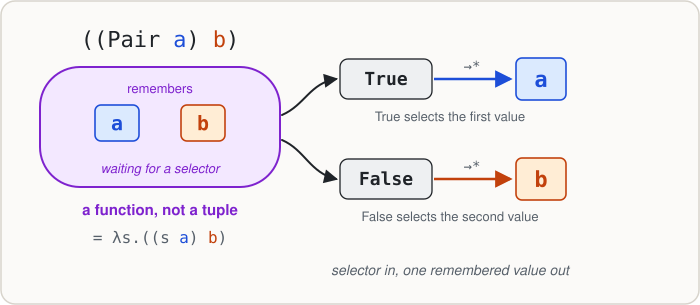

---
search:
  exclude: true
---

# Module 08.2: Encoding Data with Functions

In Module 08.1, we learned an entire programming language with only three forms:

```text
variable
(expr expr)
(λ variable . expr)
```

We also learned the one central computation rule: **apply a function by β-reduction**.

But there is a problem.

We would like to write programs involving things such as:

```haskell
True
False
(3, 5)
[1, 2, 3]
42
```

None of those values exists as a primitive in pure lambda calculus. There aren't even built-in numbers.

Rather than adding new primitives, we'll try something more surprising:

> **Represent familiar data by functions that behave the way that data is supposed to behave.**

This module prepares you for **Lab 08**, the lambda-calculus encoding lab. It explains the Boolean and pair operations already provided in the lab, explores how the supplied list representation works, and introduces Church numerals. It deliberately **does not implement the list and arithmetic operations that you will implement yourself in lab**.

By the end, you should be able to explain functional encodings of Booleans and pairs, read the lab's supplied list representation, interpret Church numerals as repeated function application, and explain why a function can serve as a representation of a value.

!!! note "How to use this module"
    When you see a box labeled **Gradescope question**, answer that question in the **Module 8.2 Completion** assignment on Gradescope.

!!! note "Capitalized names are abbreviations"
    Capitalized names such as `True`, `Pair`, and `Succ` are **convenient abbreviations** defined in a `.lc` file, and numerals such as `2` are abbreviations built into the `lc` interpreter. They are not additional primitive features of pure lambda calculus. They can be expanded into expressions containing only variables, abstractions, and applications.

---

## What Makes a Representation Good?

Suppose we wanted to represent a pair of values, but our language didn't have a pair datatype.

One approach would be to complain that pairs are impossible.

Another approach is to ask a more useful question:

> **What do we actually need to be able to do with a pair?**

We need to construct it from two values, then be able to retrieve the first and second values.

If functions can provide exactly that behavior, perhaps functions are enough.

That is the idea behind an **encoding**.

An encoding is not necessarily identical to the way a computer stores a value internally. Instead, it gives us a representation whose **observable behavior** matches what we need.

We'll proceed from the simplest case to more interesting ones:

```text
functions that choose      →  Booleans
functions that remember    →  pairs
combinations of the above  →  lists
functions that repeat      →  numbers
```

---

## Booleans as Functions That Choose

Think about what you actually **do** with a Boolean.

Usually you use it to decide which of two alternatives to select:

```haskell
if condition
  then firstChoice
  else secondChoice
```

So what if a Boolean were itself a function that selects one of two arguments?

### Our encoding of `True`

```text
True = (λx.(λy.x))
```

This is a curried function of two arguments.

It takes `x`, then `y`, and returns `x`.

In other words:

```text
((True firstChoice) secondChoice)
                  →*
firstChoice
```

The notation `→*` means *zero or more reduction steps*; unlike `→β`, it doesn't claim the whole result happens in exactly one step.

Let's check the behavior by expanding the abbreviation:

```text
((True a) b)

= (((λx.(λy.x)) a) b)

→β ((λy.a) b)

→β a
```

It chooses its **first** argument.

### Our encoding of `False`

```text
False = (λx.(λy.y))
```

This time the result is the second argument:

```text
((False a) b)

= (((λx.(λy.y)) a) b)

→β ((λy.y) b)

→β b
```

It chooses its **second** argument.

### We have an `if` expression

Once we have these two values, we don't need a built-in conditional.

A conditional can simply be:

```text
((condition thenBranch) elseBranch)
```

If the condition is `True`, we select `thenBranch`. If it is `False`, we select `elseBranch`.

That is the essential behavior of `if-then-else`.

!!! note "An important subtlety"
    A Church Boolean selects a branch by function application. In a reduction strategy that evaluates the unused branch first, that unused branch might still be evaluated. So the branch-selection analogy works most directly with a reduction strategy that allows an unused argument to remain unevaluated, as in our earlier discussion of lazy evaluation.

{ width="680" }

!!! question "Gradescope question: Booleans are selectors"
    **Submit this response on Gradescope.**

    Without doing every reduction step, predict the result of:

    ```text
    ((True p) q)
    ((False p) q)
    ```

    Then explain, in one or two sentences, how the `True` and `False` encodings collectively give us the behavior of an `if-then-else` expression.

---

## Boolean Operations from Selection

We can now build familiar operations without adding new language features.

Start by thinking about how **NOT** behaves:

```text
Not True  →* False
Not False →* True
```

A Boolean already chooses between two options. To reverse its meaning, simply reverse which answer is chosen.

```text
Not = (λb.((b False) True))
```

If `b` is `True`, it chooses `False`. If `b` is `False`, it chooses `True`.

We can reason similarly about **AND**.

In Haskell:

```haskell
and a b =
  if a then b else False
```

Our encoded `a` can already act as the condition:

```text
And = (λa.(λb.((a b) False)))
```

Try the `False` case:

```text
((And False) True)
```

The first argument (`False`) chooses its second branch, so the result is `False`, regardless of the second Boolean.

**OR** works similarly. In Haskell:

```haskell
or a b =
  if a then True else b
```

So we can encode it as:

```text
Or = (λa.(λb.((a True) b)))
```

These are the same Boolean operations already provided in the lab's starter file:

```text
True
False
Not
And
Or
```

**Don't memorize the definitions.** Notice the method:

1. Describe an operation using ordinary conditional behavior.
2. Observe that our encoded Boolean **is already a chooser**.
3. Give it the alternatives corresponding to the operation.

!!! question "Gradescope question: Reasoning from behavior"
    **Submit this response on Gradescope.**

    In ordinary Haskell, we could define OR using:

    ```haskell
    or a b =
      if a then True else b
    ```

    Why does that suggest the lambda-calculus encoding:

    ```text
    Or = (λa.(λb.((a True) b)))
    ```

    In particular, what happens when `a` is `True`, and what happens when `a` is `False`?

---

## Pairs as Functions That Remember Two Values

Booleans are functions that **choose**.

A pair should hold on to two values and return one when asked.

The key observation is that we already have functions that choose the first or second of two arguments.

So we can define a pair as a function that:

1. receives a value `x`,
2. receives a value `y`,
3. remembers both,
4. later receives a **selector** and lets that selector pick one.

Here's the provided encoding:

```text
Pair = (λx.(λy.(λb.((b x) y))))
```

At first this may look like a lot of parentheses. Read the structure as three curried arguments:

```text
x       the first stored value
y       the second stored value
b       a selector function
```

Applying `Pair` to two values produces something equivalent to:

```text
λb.((b x) y)
```

This new function remembers `x` and `y`, and when given a selector `b`, passes the two values to it.

### Recover the first component

We already know that `True` chooses its first argument:

```text
((True x) y) →* x
```

So we can recover the first component of a pair with:

```text
Fst = (λp.(p True))
```

Example:

```text
(Fst ((Pair a) b))
```

reduces to:

```text
a
```

### Recover the second component

Likewise, `False` chooses its second argument:

```text
Snd = (λp.(p False))
```

Example:

```text
(Snd ((Pair a) b))
```

reduces to:

```text
b
```

This should feel familiar from Haskell's `fst` and `snd`.

But notice what we have accomplished:

> We built the behavior of a pair without having a primitive pair datatype.

All we've used is currying, function application, and the functions we already encoded.

{ width="720" }

### Why the reuse matters

The same `True` and `False` functions are now doing two different jobs:

- implementing conditionals,
- selecting components from a pair.

This is a recurring pattern in programming-language design: once an abstraction has a well-defined behavior, that behavior can be reused in settings its designers might not initially have expected.

!!! question "Gradescope question: Pairs reuse Booleans"
    **Submit this response on Gradescope.**

    Explain why the pair operations are defined using the *same* encoded Booleans:

    ```text
    Fst = (λp.(p True))
    Snd = (λp.(p False))
    ```

    What role is `True` playing inside `Fst`? What role is `False` playing inside `Snd`?

---

## Lists Built from the Pieces We Already Have

In Haskell, lists have a recursive structure:

```haskell
data List a
  = Nil
  | Cons a (List a)
```

This is a conceptual datatype, not a definition you should add to your Haskell standard library.

A list is either:

- empty, or
- a head element together with a tail list.

We could imagine a lambda-calculus encoding based on our existing Booleans and pairs.

### The lab's list representation

Lab 08 uses a simple **tagged representation**.

Think of every list as a pair:

```text
(tag, payload)
```

The tag tells us whether the list is empty.

An empty list has the conceptual representation:

```text
(True, unused)
```

A nonempty list has:

```text
(False, (head, tail))
```

So we can picture:

```text
[]       ↔  (True, unused)

[a]      ↔  (False, (a, (True, unused)))

[a, b]   ↔  (False, (a, (False, (b, (True, unused)))))
```

These are **conceptual pictures**, not literal tuple values in the pure lambda calculus. In the provided `.lc` file, each pair and Boolean is itself an encoded function.

### The supplied constructors

The lab already gives you a definition for the empty list:

```text
Nil = ((Pair True) True)
```

The second `True` is just a convenient unused placeholder.

It also gives you a constructor for nonempty lists:

```text
Cons = (λh.(λt.((Pair False) ((Pair h) t))))
```

Read it as:

> Given a head `h` and tail `t`, create a nonempty list with those components.

So:

```text
((Cons a) Nil)
```

represents a one-element list, and:

```text
((Cons a) ((Cons b) Nil))
```

represents a two-element list.

### What remains for the lab?

Having a representation is **not the same as having all the operations** we want on it.

In the lab, you'll derive functions for recognizing the empty list and retrieving parts of a nonempty list. You have all the pieces needed to work out those operations from the representation, but **we won't implement them here**.

This is where the encoding stops being something to observe and becomes something you'll construct yourself.

!!! question "Gradescope question: Read a representation"
    **Submit this response on Gradescope.**

    In the lab's tagged list representation, what does the outer Boolean in a list encoding tell us?

    For a *nonempty* list, what kind of information is stored in the second component of its outer pair?

    Explain using the conceptual representation, **without writing an `IsNil`, `Head`, or `Tail` implementation**.

---

## Church Numerals: Numbers as Repetition

We have encoded logical choices and data containers.

What about numbers?

One possible answer is:

> A nonnegative integer describes how many times we want to do something.

For example, the number `3` can be thought of as:

```text
Apply f
Apply f
Apply f
```

starting from some initial value `x`.

This is the idea of a **Church numeral**.

### Zero applications

```text
0 = (λf.(λx.x))
```

`0` takes a function `f` and a starting value `x`, then returns `x` unchanged.

It applies `f` zero times.

### One application

```text
1 = (λf.(λx.(f x)))
```

It applies `f` once.

### Two applications

```text
2 = (λf.(λx.(f (f x))))
```

It applies `f` twice.

### Three applications

```text
3 = (λf.(λx.(f (f (f x)))))
```

It applies `f` three times.

These names `0`, `1`, `2`, and `3` are **abbreviations** for lambda expressions. They do not add numeric literals to the underlying calculus.

### A concrete way to understand them

Imagine that `f` means "put one sticker on a notebook" and `x` is a notebook with no stickers.

Then:

```text
((0 f) x)  = x
((1 f) x)  = (f x)
((2 f) x)  = (f (f x))
((3 f) x)  = (f (f (f x)))
```

The numeral does not need to know what a sticker or notebook is. It only controls **how many times** the provided operation happens.

That makes Church numerals more general than any particular numeric representation.

{ width="720" }

### This is already higher-order programming

Church numerals are functions that take **other functions** as arguments.

This connects back to higher-order functions in Haskell: we already know examples such as `map`, which receives a function and determines how to apply it over a structure.

A Church numeral receives a function and determines how many times to apply it.

---

## Building Arithmetic from Repeated Application

If numbers are represented by repetition, arithmetic becomes a question about **how repetitions combine**.

### Successor: one more application

Suppose `n` represents the ability to apply `f` exactly `n` times.

What should a successor operation do?

It should return something that applies `f` exactly **one more time**.

The lab already supplies:

```text
Succ = (λn.(λf.(λx.(f ((n f) x)))))
```

Read the inside out:

1. `((n f) x)` applies `f` to `x` exactly `n` times.
2. The outer `f` applies it **once more**.
3. Therefore `(Succ n)` represents `n + 1`.

There is no built-in `+ 1` anywhere in this definition.

Let's inspect the behavior using Church numerals:

```text
(Succ 2)
```

should act like `3`:

```text
(((Succ 2) f) x)  →*  (f (f (f x)))
```

The exact normal-form expression may look different depending on where or how we expand the abbreviation, but the **repetition behavior** is the important part.

### Addition

Conceptually, adding `m` and `n` means doing something `m` times and then doing it another `n` times.

### Multiplication

Conceptually, multiplying `m` and `n` means arranging repetitions so that the total number of applications is `m × n`.

### Predecessor and subtraction

Taking one application **away** is trickier than adding one. The lab uses a clever technique involving pairs to support predecessor and subtraction. Some of that machinery is provided, and you'll complete a missing helper.

We are deliberately **not** writing the lambda expressions for `Plus`, `Times`, or the missing helper used by `Pred` here. Those are central problems in Lab 08.

The important preparation is to understand **what the Church numeral representation offers** and how to reason about the effect of applying functions a certain number of times.

!!! question "Gradescope question: Why does successor work?"
    **Submit this response on Gradescope.**

    Consider the provided definition:

    ```text
    Succ = (λn.(λf.(λx.(f ((n f) x)))))
    ```

    Explain what the subexpression `((n f) x)` does.

    Then explain why placing one more `f` around it gives the behavior of `n + 1`.

---

## A Representation Can Support Many Operations

We've seen a useful recurring strategy:

**Booleans:** represent a truth value by *which argument a function selects*.

**Pairs:** represent two stored values by *a function that accepts a selector*.

**Lists:** represent a recursive data structure by *combining simpler encodings*.

**Numbers:** represent nonnegative integers by *how often a function is applied*.

What these examples share is more important than any single encoding:

> We start from the behavior we want and work backward to a representation built from the constructs we already have.

This should reconnect to earlier course ideas about abstract data types and representation independence.

We have also seen that an encoding can make some operations easy and others difficult. Successor is simple for Church numerals; predecessor takes more ingenuity. That is a tradeoff arising from the **choice of representation**.

---

## Before Lab 08

Next up is **Lab 08**, the lambda-calculus encoding lab.

You'll work with a supplied `.lc` file that already contains functional representations of Booleans, pairs, and several number operations. Your job will be to fill in selected missing list and arithmetic functions.

For the lab, focus on a reliable process:

1. Read the behavioral specification of the function you're implementing.
2. Identify the representation you're given.
3. Express the desired behavior in terms of operations that are **already available**.
4. Build the new function using lambda abstractions and applications.
5. Test one small case before trying a more complex one.

You can use the CS 131 server's `lc` interpreter to load a `.lc` file with `:load filename.lc` and reload edits with `:reload`.

The lab is not asking you to memorize complicated expressions. It asks you to **design with a very small set of building blocks**.

Module 08.3 pushes the same idea further. It asks how a language with no built-in names for recursive functions can nevertheless support recursion.

---

## Finish Module 08.2

Make sure you've answered the five Gradescope questions embedded above:

1. Booleans are selectors
2. Reasoning about OR
3. Pairs reuse Booleans
4. Reading the lab's list representation
5. Why successor works

!!! question "Gradescope question: Time spent"
    **Submit this response on Gradescope.**

    Approximately how much time did you spend on this module?

    - less than 30 minutes
    - 30 - 45 minutes
    - 45 - 60 minutes
    - 60 - 75 minutes
    - 75 - 90 minutes
    - more than 90 minutes

!!! question "Gradescope question: Lingering questions"
    **Submit this response on Gradescope.**

    What lingering questions or thoughts do you have about this module?
